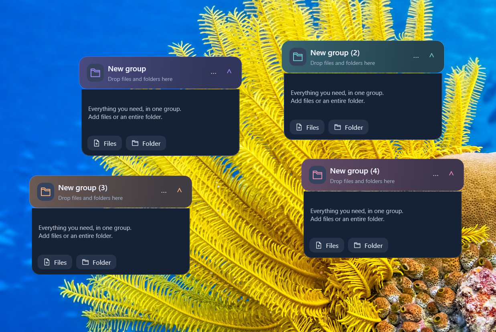
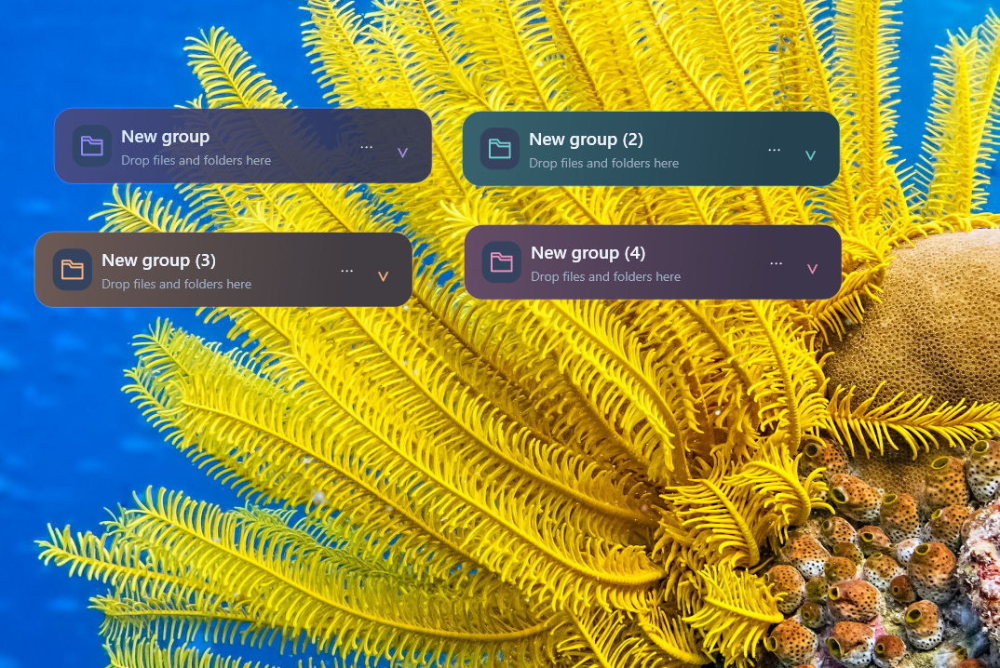
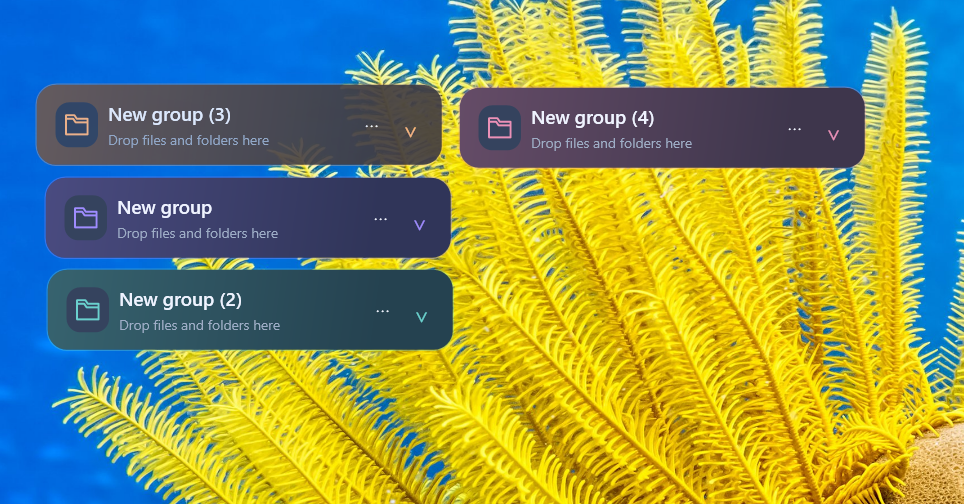
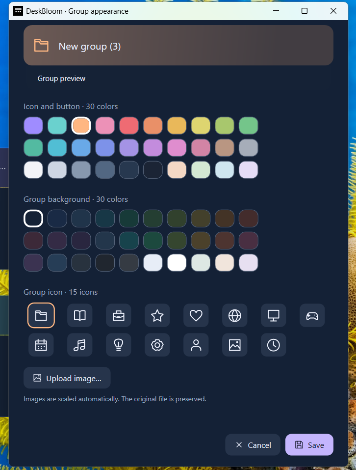
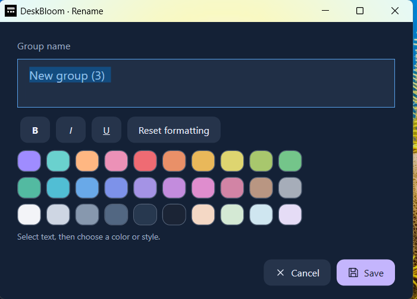
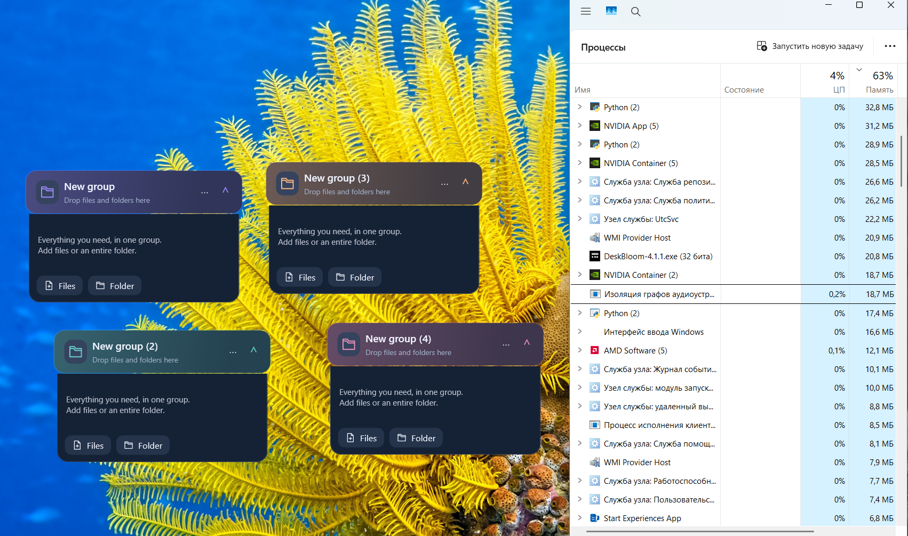

# DeskBloom

[Русский](README.ru.md) · [Download for Windows](https://github.com/treyer012-commits/DeskBloom/releases)

Collapsible file groups on your normal Windows desktop. **Made with the help of AI.**

- Click a group header to show or hide its files; drag it to move the group.
- Separate color palettes, 15 icons, custom images and formatted group names.
- English and Russian. Typically **16–30 MB RAM in the tested scenarios**; usage varies with workload.

Windows 10/11 with .NET Framework 4.8. Download the Setup installer from **Releases**; administrator rights are not required. A portable ZIP is also available.

## Your files

Groups are ordinary folders, normally in **Documents\DeskBloom Groups** (or **Documents\Группы Desk Bloom**). Groups created in another folder stay there. Settings are in **Documents\DeskBloom**; each group also has a `.groups` settings file. Adding files moves them into the group. Uninstalling keeps your group files and settings.

## Screenshots

More screenshots: collapsed groups, appearance, title formatting and memory

## Source and terms

Source code can be viewed and used privately. **Redistribution of the program, source code, installer or modified versions requires the author's written permission.** GitHub viewing/forking rights remain governed by GitHub's terms. See [LICENSE](LICENSE).

Build from source with `src\build-DeskBloom.ps1`; add `-Diagnostics` for tests and benchmarks. Installer source: [installer](installer). [Usage](docs/usage-en.txt) · [Memory measurements](docs/memory-4.1.md).
