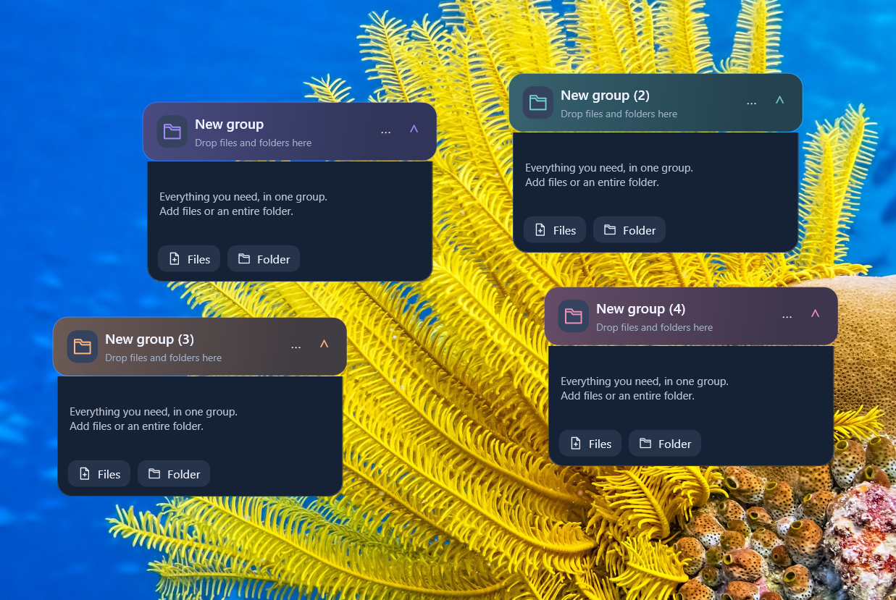
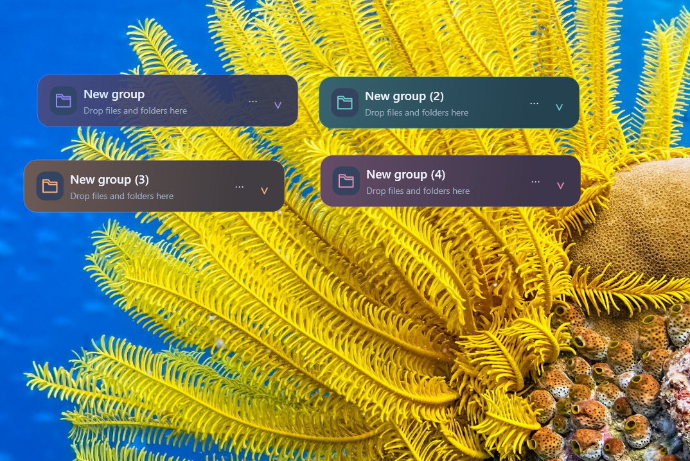
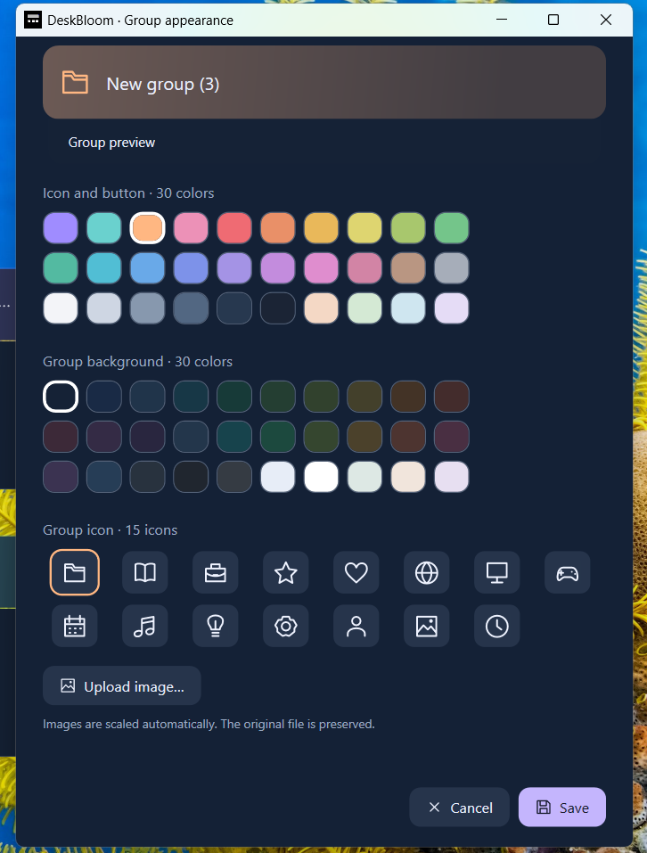
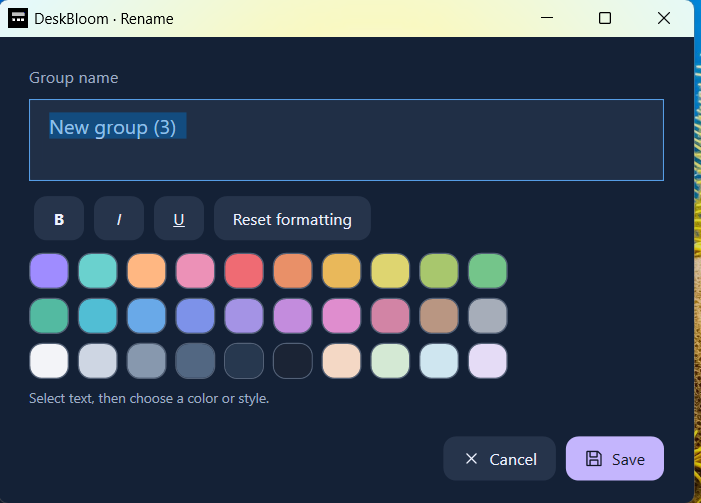
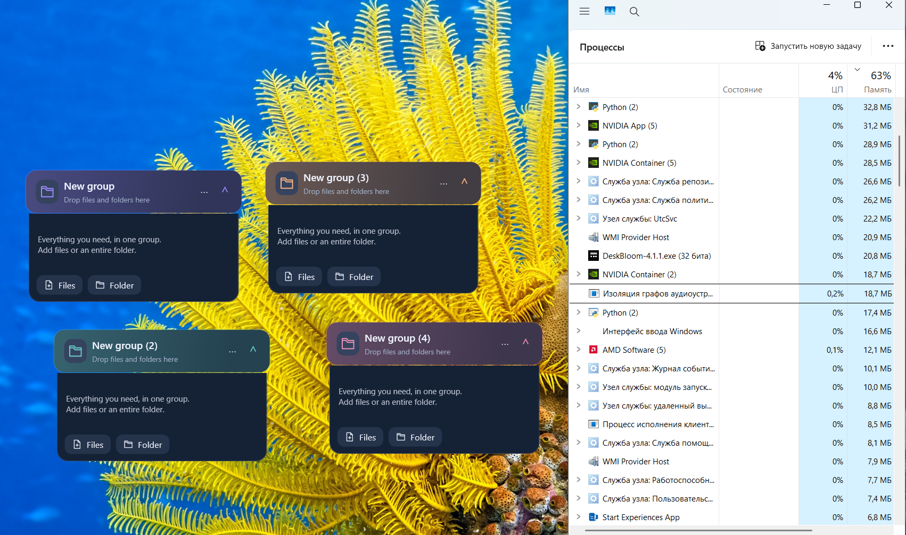

# DeskBloom

[English](README.md) · [Скачать для Windows](https://github.com/treyer012-commits/DeskBloom/releases)

Группы файлов на обычном рабочем столе Windows. **Программа создана с помощью ИИ.**

- Нажатие на заголовок раскрывает или сворачивает файлы; перетаскивание перемещает группу.
- Отдельные палитры цветов, 15 значков, свои изображения и форматирование названий.
- Русский и английский языки. Обычно **16–30 МБ памяти в проверенных сценариях**; расход зависит от нагрузки.

Windows 10/11 и .NET Framework 4.8. Установщик **Setup** находится в разделе **Releases**, права администратора не нужны. Также доступна переносимая версия ZIP.

## Где находятся файлы

Группы — обычные папки, обычно в **Документы\Группы Desk Bloom** или **Документы\DeskBloom Groups**. Группа, созданная в другой папке, хранится там же. Настройки — в **Документы\DeskBloom**, а внутри каждой группы есть файл настроек `.groups`. Добавляемые файлы физически переносятся в папку группы. При удалении общие настройки, служебные запросы и автозапуск очищаются. Папки групп и файлы `.groups` остаются для восстановления после переустановки.

## Скриншоты

Ещё: свёрнутые группы, оформление, название и расход памяти

## Авторы

Автор: **tru tre**, при участии **OpenAI Codex** (ИИ-помощник в программировании).

## Код и условия

Код доступен для просмотра, изучения и личного использования. **Распространение программы, исходников, установщика и изменённых версий запрещено без письменного разрешения автора.** Просмотр и форки внутри GitHub регулируются правилами GitHub. Подробности: [LICENSE](LICENSE).

Сборка: `src\build-DeskBloom.ps1`; проверки и замеры — с параметром `-Diagnostics`. Исходники установщика: [installer](installer). [Инструкция](docs/usage-ru.txt) · [Замеры памяти](docs/memory-4.1.md).

